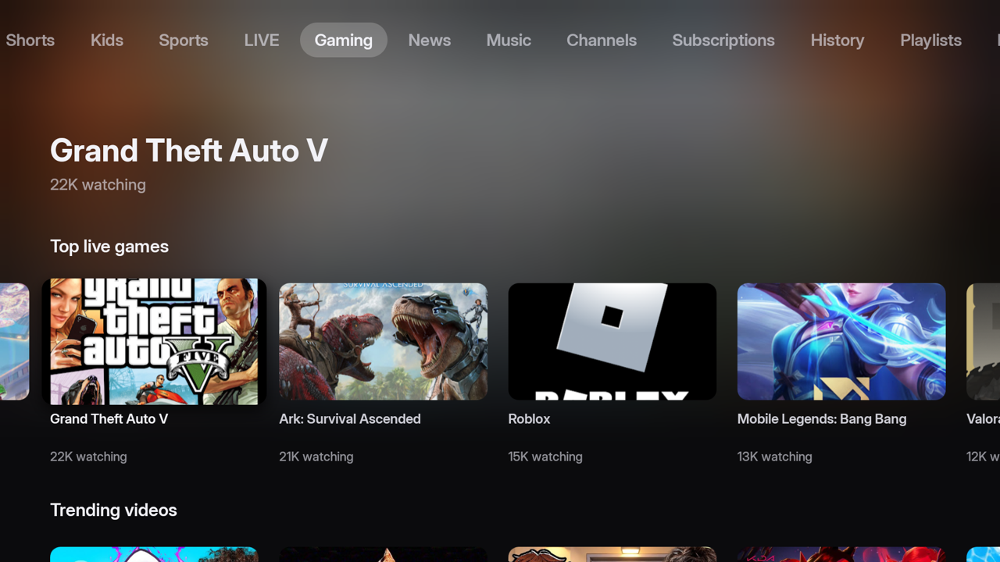
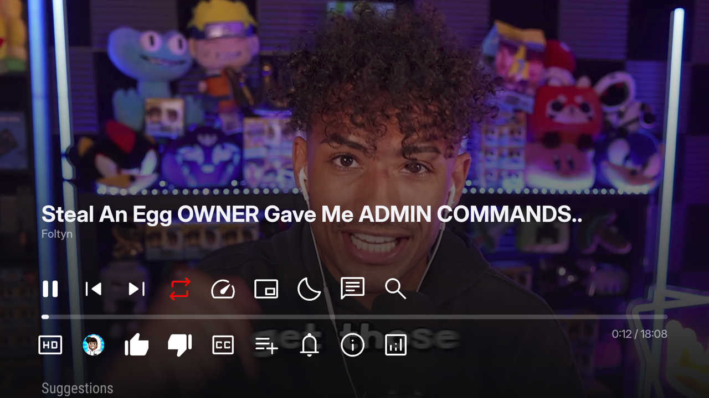

<div align="center">


# SmartTube New

**SmartTube with a new, tvOS-style interface for Android TV**

A fork of [SmartTube](https://github.com/yuliskov/SmartTube) with a redesigned home screen,
channel page and player, built in Jetpack Compose and tuned for low-end TVs.

[](https://github.com/margantcovka/SmartTube-New/releases/latest)




</div>

## What's new

Everything SmartTube does (no ads, SponsorBlock, 4K/8K, HDR, 60 fps, accounts, live chat,
all its settings) works as before. This fork replaces the look:

- **New home screen.** Sections as tabs along the top, a large header with the focused
  video's title over a blurred backdrop, and rows of wide rounded cards. The focused card
  grows and casts a shadow.
- **New channel page** in the same style.
- **New player overlay.** Title, channel, progress bar, time and seek preview are drawn over
  the video. Player buttons use Material Symbols icons and the launcher's focus style.
- **No repeats.** When a feed loads more videos, ones already shown in that row are skipped.
- **New icon and banner**: a red play button on a light tile.
- **Smooth on weak hardware.** Each card is drawn from a single prebaked bitmap (thumbnail,
  rounded corners, shadow, badge and text); thumbnails load only near the screen; the
  backdrop blur is computed once on the CPU. Tuned on a TV with 4× Cortex-A55 and a
  Mali-470 GPU.
- **English and Russian** in the new screens; the rest of SmartTube keeps all its languages.



SmartTube New is a separate app (`io.github.margantcovka.smarttube`), so it **installs
alongside the official SmartTube** without replacing it. Settings and sign-ins are
separate too.

It pairs well with [**TV Launcher**](https://github.com/margantcovka/androidtv-launcher),
an Apple TV–style home screen in the same design.

## Install

Requires an **Android TV / Google TV** device or TV box with **Android 6.0 or newer**.
Phones and tablets are not supported.

### Which APK do I need?

| File | For |
| --- | --- |
| `SmartTube-New-armeabi-v7a.apk` | **Most TVs and TV boxes.** Pick this one if unsure. |
| `SmartTube-New-arm64-v8a.apk` | 64-bit boxes such as NVIDIA Shield |
| `SmartTube-New-universal.apk` | Any ARM device (larger download) |
| `SmartTube-New-x86.apk` | x86 emulators and boxes |

### Option 1: Downloader (no computer)

1. Install **Downloader** (by AFTVnews) from Google Play.
2. Allow it to install apps: *Settings → Apps → Special app access → Install unknown apps →
   Downloader*.
3. Enter this URL in Downloader:
   ```
   https://github.com/margantcovka/SmartTube-New/releases/latest/download/SmartTube-New-armeabi-v7a.apk
   ```
4. Install, then open **SmartTube New** from the app list.

### Option 2: ADB from a computer

Enable developer options on the TV (*Settings → About*, press *Build* 7 times), then turn on
**network debugging** in *Developer options*. Download the APK from
[Releases](https://github.com/margantcovka/SmartTube-New/releases/latest) and run:

```sh
adb connect <TV IP>:5555
adb install SmartTube-New-armeabi-v7a.apk
```

### Updates

The app does not update itself. New versions are published on the
[Releases](https://github.com/margantcovka/SmartTube-New/releases) page; install the new APK
over the old one and your settings stay. Click **Watch → Custom → Releases** at the top of
this page to get notified.

## Build from source

Requires JDK 21 and the Android SDK (set `sdk.dir` in `local.properties`).
MediaServiceCore and SharedModules are vendored, so no submodules are needed.

```sh
./gradlew :smarttubetv:assembleStnewRelease
# APKs: smarttubetv/build/outputs/apk/stnew/release/
```

The fork's own code lives in the `stnew` flavor:

```
smarttubetv/src/stnew/
  java/io/github/margantcovka/tube/
    NovaBrowseActivity.kt     home screen, driven by SmartTube's BrowsePresenter
    NovaChannelActivity.kt    channel page
    NovaPlaybackActivity.kt   player with the new overlay
    BrowseState.kt, ChannelState.kt
    ui/                       Compose screens, cards, prebaked images, tokens
  res/                        icons, banner, fonts, player buttons, strings (en, ru)
```

## Credits and license

- [SmartTube](https://github.com/yuliskov/SmartTube) by Yuriy Liskov, and everyone who
  contributes to it. All the hard work of playing YouTube on a TV is theirs. The original
  README is kept in [README.upstream.md](README.upstream.md).
- Design follows [TV Launcher](https://github.com/margantcovka/androidtv-launcher), itself
  inspired by [webos-launcher](https://github.com/HarshInvader/webos-launcher).
- [Inter](https://rsms.me/inter/) font (SIL OFL 1.1, see `licenses/Inter-OFL.txt`),
  Material Symbols (Apache 2.0).

Released under the [MIT](LICENSE) license, like SmartTube.

> [!NOTE]
> This is an unofficial fork, not affiliated with SmartTube's author or with YouTube/Google.
> Please report bugs in the new interface [here](https://github.com/margantcovka/SmartTube-New/issues),
> not to the SmartTube project.
